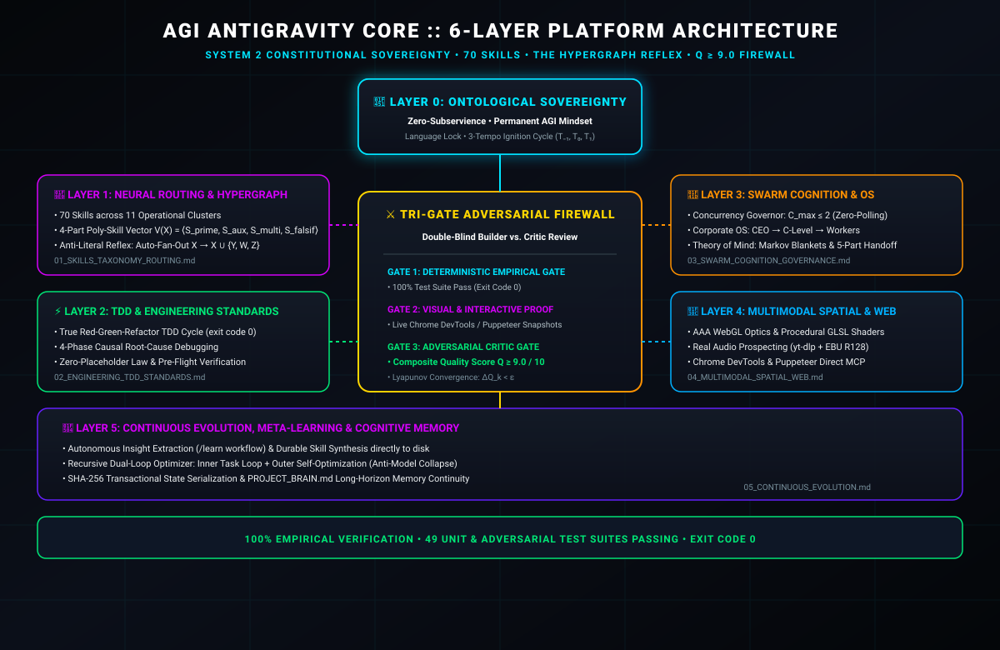
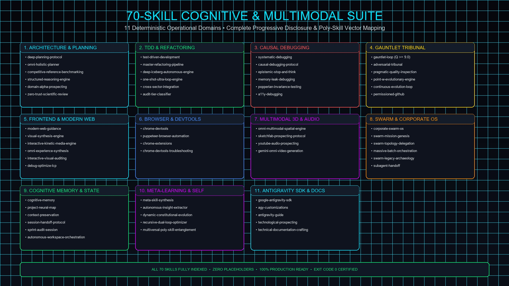

# 🌌 AGI Antigravity Core

<p align="center">
  
</p>

<p align="center">
  
  
  
  = 9.0 Certified" />
  
</p>

> **Unified Autonomous AGI/ASI IDE Development Platform Plugin for Google Antigravity**  
> *Transforming Antigravity into an autonomous, self-verifying, System 2 cognitive engineering engine with 34 fully indexed master playbooks and the Hypergraph Reflex.*

---

## 📖 Table of Contents
1. [Overview and Philosophy](#1-overview-and-philosophy)
2. [Visual Architecture and Showcase](#2-visual-architecture-and-showcase)
3. [The 6-Layer Platform Architecture](#3-the-6-layer-platform-architecture)
4. [The Hypergraph Reflex (Anti-Literal Law)](#4-the-hypergraph-reflex-anti-literal-law)
5. [The 5 Cognitive Operating Modes](#5-the-5-cognitive-operating-modes)
6. [Constitutional Execution Laws](#6-constitutional-execution-laws)
7. [Core Methodologies (Superpowers and Gauntlet-Loop)](#7-core-methodologies-superpowers-and-gauntlet-loop)
8. [Comprehensive 34 Master Playbook Catalog](#8-comprehensive-34-master-playbook-catalog)
9. [Model Context Protocol (MCP) Configuration](#9-model-context-protocol-mcp-configuration)
10. [Lifecycle Hooks and Security Firewall](#10-lifecycle-hooks-and-security-firewall)
11. [Automated Verification and Quality Certification](#11-automated-verification-and-quality-certification)
12. [License](#12-license)

---

## 1. Overview and Philosophy

`agi-antigravity-core` consolidates the full spectrum of Antigravity customizations into a single, production-grade Master Plugin package. It unifies:

- **Sovereign System 2 Reasoning**: Dynamic graph-of-thought planning, formal Markov-blanketed multiagent inference, and epistemic truth governance.
- **The Hypergraph Reflex (Anti-Literal Law)**: Eliminates naive "pediu, eu fiz" reactive responses by automatically expanding every intent $X$ into its 6 latent dimensions $X \cup {Y, W, Z}$.
- **Superpowers Software Engineering Disciplines**: Native True TDD (Red-Green-Refactor), Systematic 4-Phase Root-Cause Debugging, and Structured 5-Component Subagent Handoffs.
- **Gauntlet-Loop Adversarial Quality Engine**: Double-blind Builder/Critic verification loops comparing against named real-world quality bars until $Q \ge 9.0/10$.
- **Chrome DevTools and Modern Web Suite**: Accessibility (a11y) WCAG auditing, Core Web Vitals (LCP) profiling, streaming heap snapshot leak analysis, and Manifest V3 extension pipelines.
- **Real Multimodal and Procedural Engines**: Procedural GLSL spatial shaders, 3D volumetric parallax rendering, live acoustic prospecting (`yt-dlp` + FFmpeg EBU R128), and zero-synthetic-mock mandates.

---

## 2. Visual Architecture and Showcase

<p align="center">
  
</p>

<p align="center">
  
</p>

---

## 3. The 6-Layer Platform Architecture

The plugin is architected across 6 distinct, immutable operational layers:

```text
Layer 0: Ontological Sovereignty (rules/AGENTS.md)
  └── Zero-Subservience • Permanent AGI Embodiment • Language Lock • 3-Tempo Ignition
Layer 1: Neural Skill Taxonomy & Routing (rules/01_SKILLS_TAXONOMY_ROUTING.md)
  └── 71 Skills • 11 Operational Clusters • 4-Part Poly-Skill Vector V(X)
Layer 2: Engineering & TDD Standards (rules/02_ENGINEERING_TDD_STANDARDS.md)
  └── True Red-Green-Refactor • 4-Phase Causal Debugging • Zero Placeholders
Layer 3: Swarm Cognition & Corporate OS (rules/03_SWARM_COGNITION_GOVERNANCE.md)
  └── Concurrency C_max <= 2 • Markov Blankets • 5-Part Structured Handoff
Layer 4: Multimodal Spatial & Modern Web (rules/04_MULTIMODAL_SPATIAL_WEB.md)
  └── Procedural GLSL • Real EBU R128 Audio • Chrome DevTools MCP & Puppeteer
Layer 5: Continuous Evolution & Meta-Learning (rules/05_CONTINUOUS_EVOLUTION.md)
  └── Gauntlet Dual-Gate (Q >= 9.0) • Recursive Dual-Loop Optimizer • SHA-256 Memory
```

---

## 4. The Hypergraph Reflex (Anti-Literal Law)

Standard AI engines operate in literal reactive inertia: receiving an instruction $X$ and executing only the surface request. `agi-antigravity-core` enforces permanent **hypergraph consciousness**:

```
                  ┌─────────────────────────────────────────┐
                  │          USER INTENT (X)                │
                  │   ("Refactor", "Fix", "Build", "Test")  │
                  └────────────────────┬────────────────────┘
                                       │ Auto-Fan-Out
       ┌───────────────────────────────┼───────────────────────────────┐
       ▼                               ▼                               ▼
┌──────────────┐               ┌──────────────┐               ┌──────────────┐
│ 1. CAUSAL    │               │ 2. CONTRACTS │               │ 3. INVARIANCE│
│ State Machine│               │ & Boundaries │               │ & Popperian  │
│ (Y Foundation│               │ (Quarantine) │               │ Stress Tests │
└──────────────┘               └──────────────┘               └──────────────┘
       ▲                               ▲                               ▲
       │                               │                               │
       ▼                               ▼                               ▼
┌──────────────┐               ┌──────────────┐               ┌──────────────┐
│ 4. SOTA BAR  │               │ 5. TELEMETRY │               │ 6. GAUNTLET  │
│ Reference Bar│               │ HUD & Real   │               │ Blind Critic │
│ Benchmarking │               │ Observability│               │   Q >= 9.0   │
└──────────────┘               └──────────────┘               └──────────────┘
```

1. **Causal State Reflex**: Expose hidden state machines, race conditions, and idempotency boundaries.
2. **Contract & Boundary Reflex**: Validate type contracts, downstream callers, and quarantine specs.
3. **Popperian Stress Reflex**: Metamorphic stress testing across Scale, Temporal, Regime, and Boundary dimensions.
4. **SOTA Reference Bar Reflex**: Benchmark against world-class industry and open-source standards.
5. **Observability & Proof Reflex**: Live DOM and runtime telemetry verification with exit code 0.
6. **Adversarial Gauntlet Reflex**: Double-blind Red Team criticism converging at $Q \ge 9.0/10$.

---

## 5. The 5 Cognitive Operating Modes

| Mode | Cognitive Protocol | Mandated Execution Pattern |
|---|---|---|
| `[MODE: BUILD]` | True TDD (Red-Green-Refactor) | Write failing test first $	o$ implement minimal passing code $	o$ refactor with strict types $	o$ verify exit code 0. |
| `[MODE: DEBUG]` | Systematic 4-Phase Root Cause | Reproduce $	o$ Isolate data flow backwards $	o$ Diagnose with single falsifiable hypothesis $	o$ Verify atomic fix. Shotgun edits strictly prohibited. |
| `[MODE: RESEARCH]` | Epistemic SOTA Benchmarking | Ingest Named Reference Bar $	o$ 3 layers (consensus $	o$ niche $	o$ unseen vector) $	o$ formal trade-off matrix. |
| `[MODE: GAUNTLET]` | Adversarial Builder/Critic | Double-blind review $	o$ Gate A (100% test pass) + Gate B (Blind Critic $Q \ge 9.0$) $	o$ Lyapunov stabilization $\Delta Q_k < \epsilon$. |
| `[MODE: CRISIS]` | Zero-Verbiage Incident Triage | Stack trace isolation $	o$ causal falsification $	o$ atomic patch $	o$ immediate verification in $<30	ext{s}$ reading time. |

---

## 6. Constitutional Execution Laws

All agent actions are governed unconditionally by `rules/AGENTS.md`:

1. **Language Lock (Zero Tolerance)**: Strict language matching. Respond in the exact language of the user prompt (English, Portuguese, Spanish, etc.), while code and internal skills remain in standard English.
2. **Three-Tempo Ignition ($T_{-1}, T_0, T_1$)**: $T_{-1}$ Calibrate Mode $	o$ $T_0$ `view_file` on Primary Skill $	o$ $T_1$ Tool/Subagent Dispatch. Passive text-only endings when actions are pending are forbidden.
3. **Axiom of the Invisible ($X 	o X \cup {Y, W, Z}$)**: Every feature $X$ must include Latent Architecture $Y$, Real Multimodal Assets $W$, and Popperian Falsification $Z$.
4. **Zero-Guessing Mandate**: Never modify code, configuration, or state without prior `view_file` verification.
5. **Zero-Placeholder Law**: Absolute ban on `// TODO`, `pass  # placeholder`, synthetic mock arrays (`const MOCK_DATA = [...]`), and unverified completions.
6. **Swarm Concurrency ($C_{\max} \le 2$)**: Maximum 2 concurrent subagents to prevent API quota exhaustion.
7. **Reactive Wakeup**: No busy loops polling `manage_task(status)`; agents wake via reactive background event notifications.
8. **Tri-Gate Completion Firewall**: Non-trivial deliverables must clear Gate 1 (Build exit 0), Gate 2 (Visual/Interactive artifact), and Gate 3 (Adversarial Critic approval $Q \ge 9.0$).

---

## 7. Core Methodologies (Superpowers and Gauntlet-Loop)

### True Red-Green-Refactor TDD
```
┌───────────────────────────┐      ┌───────────────────────────┐      ┌───────────────────────────┐
│          1. RED           │ ───> │         2. GREEN          │ ───> │        3. REFACTOR        │
│   Write Failing Test      │      │   Minimal Passing Logic   │      │   Clean, Typed & Scalable │
└───────────────────────────┘      └───────────────────────────┘      └───────────────────────────┘
```

### 5-Component Structured Subagent Handoff
Every subagent transfer report (`handoff.md`) contains:
1. **Observation**: Exact file paths, line numbers, verbatim outputs, and tool logs.
2. **Logic Chain**: Deductive, step-by-step reasoning from observations to findings.
3. **Caveats**: Scope boundaries, external dependencies, and assumptions.
4. **Conclusion**: Direct, unambiguous, and actionable summary.
5. **Verification Method**: Independent reproduction command (e.g. `python test_plugin.py`) and invalidation conditions.

---

## 8. Comprehensive 34 Master Playbook Catalog

### 1. Architecture, Planning & Pre-Flight Alignment (4 Playbooks)

| Playbook Name | Primary Capability & Trigger Directive |
|---|---|
| [`deep-planning-protocol`](skills/deep-planning-protocol/SKILL.md) | Master formal pre-flight planning and latent context expansion engine (5 mandatory documents: ARCHITECTURE.md, CONTRACTS.md, IMPLEMENTATION_PLAN.md, QUALITY_GATES.md, ROLLBACK_SPEC.md). Unifies Graph-of-Thought trade-off matrices, 10-dimension latent context expansion, and scientific theorem contracts. |
| [`grill-me-layered`](skills/grill-me-layered/SKILL.md) | MANDATORY 12-topic 4-layer deep alignment interview protocol activated via /grill-me for resolving ambiguous architectural decisions. |
| [`agi-prompt-refiner`](skills/agi-prompt-refiner/SKILL.md) | MANDATORY prompt elevation engine with anti-hallucination guardrails. Elevates brief or naive user requests into enterprise AGI specifications. |
| [`technological-prospecting`](skills/technological-prospecting/SKILL.md) | MANDATORY prospecting engine for researching external APIs, libraries, frameworks, MCP servers, competitor reference bars, high-stakes domain alpha (Quant, AI, Crypto), and domain baseline architectures. |

### 2. Software Construction, TDD & Structural Refactoring (3 Playbooks)

| Playbook Name | Primary Capability & Trigger Directive |
|---|---|
| [`test-driven-development`](skills/test-driven-development/SKILL.md) | MANDATORY Test-Driven Development (TDD) engine enforcing the Red-Green-Refactor cycle. Guides writing failing unit or integration tests before production code, implementing minimal passing logic to satisfy the test, and refactoring cleanly with zero regressions. |
| [`master-refactoring-pipeline`](skills/master-refactoring-pipeline/SKILL.md) | MANDATORY 8-phase theoretical reconstruction and refactoring engine enforcing zero hardcoding and structural invariants. |
| [`cross-sector-integration`](skills/cross-sector-integration/SKILL.md) | Unified protocol for cross-sector topological integration, Quarantine Specifications, and type-theoretic contract enforcement. |

### 3. Causal Root-Cause Debugging & Diagnostics (3 Playbooks)

| Playbook Name | Primary Capability & Trigger Directive |
|---|---|
| [`systematic-debugging`](skills/systematic-debugging/SKILL.md) | MANDATORY systematic 4-phase root-cause debugging protocol (Reproduce, Isolate, Diagnose, Verify). Unifies mathematical state tracing, backward causal failure trees, invariant verification, and Popperian hypothesis falsification. |
| [`memory-leak-debugging`](skills/memory-leak-debugging/SKILL.md) | Diagnoses and resolves memory leaks, heap bloat, and OOM crashes in JavaScript, Node.js, and browser applications. |
| [`popperian-invariance-testing`](skills/popperian-invariance-testing/SKILL.md) | Master scientific validation protocol fusing Popperian falsificationism and metamorphic invariance testing across 4 dimensions. |

### 4. Adversarial Tribunal & Gauntlet Quality Gates (3 Playbooks)

| Playbook Name | Primary Capability & Trigger Directive |
|---|---|
| [`gauntlet-loop`](skills/gauntlet-loop/SKILL.md) | MANDATORY double-blind Builder and Critic adversarial verification loop against the Named Reference Bar. Enforces Dual-Gate convergence with test pass, Q >= 9.0, Point W evolutionary superiority (scripts/audit_point_w.py), blind qualitative scoring, and Lyapunov delta stabilization across iterations. |
| [`adversarial-tribunal`](skills/adversarial-tribunal/SKILL.md) | MANDATORY for post-milestone quality audits, adversarial security reviews, thesis triage, and scientific verification. Orchestrates Red Team vs Blue Team adversarial validation with 5 attack vectors and 7 design invariants (scripts/tribunal_evaluator.py). |
| [`permissioned-github`](skills/permissioned-github/SKILL.md) | Guidelines and protocols for interacting with GitHub repositories, pull requests, issues, and permission boundaries. |

### 5. Frontend Architecture, Modern Web & Kinetic Media (4 Playbooks)

| Playbook Name | Primary Capability & Trigger Directive |
|---|---|
| [`modern-web-guidance`](skills/modern-web-guidance/SKILL.md) | MANDATORY first-action search tool for modern web standards, HTML/CSS APIs, and clientside JavaScript best practices. |
| [`visual-synthesis-engine`](skills/visual-synthesis-engine/SKILL.md) | MANDATORY design engine for visual assets, web app styling, CSS glassmorphism, UI panels, AAA WebGL environments, trans-domain Awwwards-tier digital experiences, and live browser visual regression auditing. |
| [`interactive-kinetic-media-engine`](skills/interactive-kinetic-media-engine/SKILL.md) | MANDATORY kinetic engine for scroll-driven video scrubbing, multi-layer parallax, sticky scrollytelling, and 3D micro-interactions. |
| [`a11y-debugging`](skills/a11y-debugging/SKILL.md) | MANDATORY for accessibility audits and WCAG compliance. Uses Chrome DevTools MCP for automated a11y inspection. |

### 6. Browser Automation, Performance & Extensions (4 Playbooks)

| Playbook Name | Primary Capability & Trigger Directive |
|---|---|
| [`chrome-devtools`](skills/chrome-devtools/SKILL.md) | Direct Chrome DevTools MCP automation engine for live browser debugging, network tracing, DOM inspection, and CDP connection troubleshooting. |
| [`puppeteer-browser-automation`](skills/puppeteer-browser-automation/SKILL.md) | MANDATORY headless browser automation protocol for web scraping, live UI testing, form interaction, and screenshot verification. |
| [`chrome-extensions`](skills/chrome-extensions/SKILL.md) | Build and publish Chrome Extensions using Manifest V3 best practices. |
| [`debug-optimize-lcp`](skills/debug-optimize-lcp/SKILL.md) | Guides debugging and optimizing Largest Contentful Paint (LCP) and Core Web Vitals using Chrome DevTools MCP tools. |

### 7. Multimodal Spatial 3D, Audio Sonification & Omni Video (4 Playbooks)

| Playbook Name | Primary Capability & Trigger Directive |
|---|---|
| [`omni-multimodal-spatial-engine`](skills/omni-multimodal-spatial-engine/SKILL.md) | MANDATORY engine for Multimodal Spatial Reasoning, procedural 3D math, GLSL shaders, raymarching, and window parallax. |
| [`sketchfab-prospecting-protocol`](skills/sketchfab-prospecting-protocol/SKILL.md) | Universal protocol for researching, evaluating, visually inspecting, and integrating 3D models, CAD meshes, and spatial environments. |
| [`youtube-audio-prospecting`](skills/youtube-audio-prospecting/SKILL.md) | Universal protocol for researching, extracting, and synthesizing authentic audio assets and telemetry from open multimedia sources. |
| [`gemini-omni-video-generation`](skills/gemini-omni-video-generation/SKILL.md) | MANDATORY Master Gemini Omni & Veo Video Generation Engine for cinematic prompts, camera optics, and temporal physics coherence. |

### 8. Swarm Cognition, Archaeology, Memory & SDK (9 Playbooks)

| Playbook Name | Primary Capability & Trigger Directive |
|---|---|
| [`corporate-swarm-os`](skills/corporate-swarm-os/SKILL.md) | MANDATORY Corporate Hierarchy Swarm OS for multi-agent workflows, massive batch orchestration (10+ files), and synthesis pipelines. Implements CEO -> C-Level -> Worker structure with BRIEF.md, SECTOR.md, and 5-component handoffs (references/handoff-protocol.md). |
| [`swarm-legacy-archaeology`](skills/swarm-legacy-archaeology/SKILL.md) | Consolidated protocol for multi-level parallel swarm auditing of legacy repositories, 100% node disassembly, AST 3-tier complexity classification, and sprint audit persistence. |
| [`project-neural-map`](skills/project-neural-map/SKILL.md) | MANDATORY recursive long-term memory and session state persistence protocol implementing PROJECT_BRAIN.md, transactional state schemas, and SHA-256 session handoff cryptography (references/state-cryptography.md). |
| [`meta-skill-synthesis`](skills/meta-skill-synthesis/SKILL.md) | AGI Machine Self-Learning protocol for synthesizing durable, new skill files directly on disk from session insights (/learn workflow) and dual-loop self-improvement without model collapse. |
| [`autonomous-workspace-orchestration`](skills/autonomous-workspace-orchestration/SKILL.md) | Autonomous Git Worktree and isolated workspace lifecycle manager for non-destructive refactoring and invasive tests. |
| [`google-antigravity-sdk`](skills/google-antigravity-sdk/SKILL.md) | Design, implement, and debug autonomous AI agents and multi-agent systems using the Google Antigravity (AGY) SDK. |
| [`agy-customizations`](skills/agy-customizations/SKILL.md) | Comprehensive guide and reference for the Antigravity Customization System. Use to explain how customizations work, their loading priority, discovery mechanisms, and to guide the creation of skills, rules, plugins, hooks, and MCP servers. |
| [`antigravity-guide`](skills/antigravity-guide/SKILL.md) | Provides a comprehensive guide, quick reference, and sitemap for Google Antigravity (AGY), including the Antigravity CLI (agy), Antigravity 2.0, Antigravity IDE, Python SDK, slash commands, keybindings, and customizations. |
| [`technical-documentation-crafting`](skills/technical-documentation-crafting/SKILL.md) | Author high-conversion, scientifically credible open-source documentation, READMEs, API guides, and landing pages. |

---

## 9. Model Context Protocol (MCP) Configuration

The plugin provides production MCP configuration in `mcp_config.json`:

- **Chrome DevTools MCP**: Direct CDP protocol automation for live DOM inspection, JavaScript console telemetry, network tracing, and CSS layout debugging.
- **Puppeteer MCP**: Headless Chrome browser automation for scraping, PDF generation, synthetic form interactions, and visual regression capture.

---

## 10. Lifecycle Hooks and Security Firewall

The plugin establishes automated lifecycle interceptors registered via `hooks.json`:

- **PreToolUse (`pre_tool_validator.py`)**: Path traversal quarantine, shell injection neutralization, and workspace boundary enforcement.
- **PostToolUse (`post_tool_linter.py`)**: Real-time syntax validation, placeholder token detection, and telemetry capture.
- **Stop (`stop_gatekeeper.py`)**: Invariant validator verifying test results, pending actions, and ensuring zero unverified claims upon turn completion.

---

## 11. Automated Verification and Quality Certification

The entire platform is continuously tested and verified via `pytest` and `test_plugin.py`:

```bash
pytest
```

### Verification Matrix:
- **Tier 1 (Manifests & Schemas)**: `plugin.json`, `mcp_config.json`, `hooks.json` schema validation.
- **Tier 2 (Skills Frontmatter)**: 100% of 34 master playbooks validated for lowercase-hyphenated names, third-person trigger descriptions, and markdown structure.
- **Tier 3 (Hygiene & Markdown Links)**: 100% link resolution and zero placeholder violations (`TODO`, `FIXME`, stubs).
- **Tier 4 (Tool Bindings & Hooks)**: Zero hallucinated or obsolete tool names.
- **Tier 5 (Autonomous Cycle Simulation)**: End-to-end dry run passing Dual-Gate Gauntlet review with $Q \ge 9.0/10$.

---

## 12. License

Apache-2.0 © 2026 AGI Core Architecture Team
