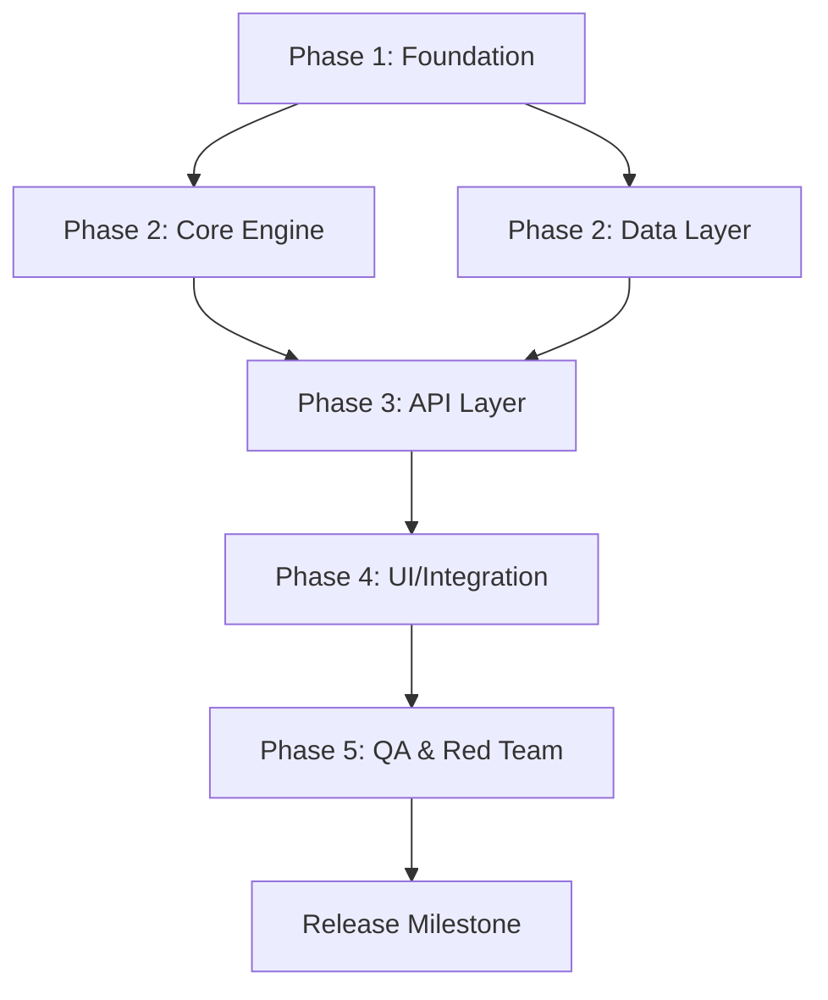

# 📐 DEEP PLANNING PROTOCOL — 5-Document Pre-Flight Gate

> 🔴 **ABSOLUTE LAW:** Writing any implementation code, creating any production source files, or instantiating engineering subagents without having all 5 pre-flight planning documents 100% complete and explicitly approved by the user is STRICTLY PROHIBITED. Zero exceptions. Zero shortcuts. Planning is the bedrock; code written without planning is entropy.

---

## ACTIVATION TRIGGERS

This skill is MANDATORILY activated when:
- Any new project with 3+ implementation files is initiated
- Any significant architectural refactoring is undertaken
- Any new subsystem, engine, or platform layer is introduced
- `/grill-me` alignment interview has concluded and answers were synthesized
- The user states "let's begin", "start implementing", or equivalent following design discussions

---

## THE 5 MANDATORY PLANNING DOCUMENTS

All 5 documents are generated sequentially by the agent in `.planning/`. The user approves them prior to implementation.

---

### 📄 DOCUMENT 1 — ARCHITECTURE.md

**Purpose:** Comprehensive, irrevocable technical structure of the system.

**Mandatory Fields:**
```markdown
# ARCHITECTURE — [Project Name]
> Created at: [timestamp] | Approved by: [user] on [date]

## Technology Stack
- Language(s): [with exact versions]
- Framework(s): [with exact versions]
- Database / Storage: [technology + version]
- Infrastructure / Runtime: [execution environment]

## Component Diagram
[Mermaid diagram or ASCII topology depicting all modules and their interconnections]

## Primary Data Flow
[End-to-end call sequence, event cycles, and data transformations]

## Architectural Patterns Adopted
[e.g., Event-Driven, CQRS, Clean Architecture — with formal rationale]

## Irrevocable Decisions (DEC::LOCKED)
[Decisions that CANNOT be reversed without total system rewrite]

## Future Extension Vectors
[Where the system is architected to scale without breaking contracts]
```

---

### 📄 DOCUMENT 2 — RESEARCH.md

**Purpose:** State of the Art (SOTA), global industry benchmarks, and comparative alternatives analysis.

**Mandatory Fields:**
```markdown
# RESEARCH — [Project Name]

## State of the Art (SOTA)
[The best existing solutions in industry/academia for this problem domain]

## Consulted Technical References
[Papers, official documentation, reference repositories, articles with URLs]

## Evaluated Libraries & Frameworks
| Library | Pros | Cons | Decision |
|---|---|---|---|
| lib-A | ... | ... | ADOPTED |
| lib-B | ... | ... | REJECTED |

## Fundamental Trade-offs
[The 3-5 most critical design tensions and how they were resolved]

## Expected Performance Benchmarks
[Baseline metrics: latency targets, throughput, memory envelope]

## Identified Anti-Patterns
[What NOT to do in this technical domain and why]
```

---

### 📄 DOCUMENT 3 — CONTRACTS.md

**Purpose:** Formal interface contracts between subsystems — the immutable handshake across boundaries.

**Mandatory Fields:**
```markdown
# CONTRACTS — [Project Name]

## Inter-Module Interface Contracts

### [Module A] → [Module B]
- **Input:** [exact type, schema, payload format]
- **Output:** [exact type, schema, payload format]
- **Precondition:** [what must hold true prior to invocation]
- **Postcondition:** [what is guaranteed upon completion]
- **Invariant:** [what must never change throughout execution]
- **Side Effects:** [expected side effects — I/O, state mutations, etc.]
- **Failure Modes:** [enumerated error taxonomy and signaling mechanism]

## Data Schemas & Types

### [Entity / Schema Name]
```typescript
// Formal type definition
interface [Name] {
  field: type; // invariant: [constraint]
}
```

## Asynchronous & Concurrency Contracts
[Ordering guarantees, idempotency keys, retry budgets, at-least-once vs exactly-once semantics]
```

---

### 📄 DOCUMENT 4 — RISKS.md

**Purpose:** Exhaustive taxonomy of technical and architectural risks paired with concrete deterministic mitigations.

**Mandatory Fields:**
```markdown
# RISKS — [Project Name]

## Risk Matrix

| Risk ID | Description | Likelihood | Impact | Concrete Mitigation | Owner |
|---|---|---|---|---|---|
| R-001 | [description] | High/Med/Low | Critical/High/Med/Low | [actionable mitigation] | [sector] |

## Critical Technical Risks
[Deep-dive into top-3 risks with step-by-step contingency protocols]

## Architectural Single Points of Failure (SPOF)
[Decisions that could become bottlenecks or single points of failure]

## Rollback Specification
[Deterministic procedure to restore pristine state if phase execution fails]

## Dangerous Assumptions (DEC::SPECULATIVE)
[Unverified assumptions — and the empirical tests designed to falsify them]
```

---

### 📄 DOCUMENT 5 — TIMELINE.md

**Purpose:** Directed Acyclic Graph (DAG) of tasks with strict dependency edges, milestones, and quality gates.

**Mandatory Fields:**
```markdown
# TIMELINE — [Project Name]

## Execution DAG



## Milestones & Tri-Gate Criteria

| Milestone | Deliverables | Quality Gate | Minimum Q-Score |
|---|---|---|---|
| M1: Foundation | ARCHITECTURE.md approved, scaffolding established | Manual Review | — |
| M2: Core Engine | Engine operating against authentic data | Gate 1: exit code 0 | 7.0 |
| M3: Integration | API + UI connected and verified | Gate 2: Full HD visual proof | 8.0 |
| M4: Release | Red Team zero critical defects | Gate 3: Adversarial Tribunal | 9.0 |

## External Dependencies
[Third-party APIs, authentic datasets, credentials required prior to kickoff]

## Formal Definition of "DONE"
[Objective, measurable verification criteria determining total project completion]
```

---

## EXECUTION PROTOCOL

### Step 1: Generate All 5 Documents
The agent creates each document on disk in `.planning/`:
```
[project-root]/
  .planning/
    ARCHITECTURE.md
    RESEARCH.md
    CONTRACTS.md
    RISKS.md
    TIMELINE.md
```

### Step 2: Present Summary to the User
After creating all 5 documents, the agent presents a structured summary and **STOPS IMMEDIATELY**:

```
✅ PRE-FLIGHT PLANNING COMPLETE — 5/5 documents generated

📄 ARCHITECTURE.md — [N] components mapped, stack defined
📄 RESEARCH.md — [N] alternatives evaluated, [N] libraries analyzed
📄 CONTRACTS.md — [N] interface contracts formalized
📄 RISKS.md — [N] risks identified, top-3 with mitigations
📄 TIMELINE.md — [N] milestones, [N] quality gates established

⛔ EXECUTION HALTED until explicit user approval.
Review the planning documents and state: "Approved" or request specific adjustments.
```

### Step 3: Await Explicit Approval
The agent will NOT write a single line of implementation code until the user approves.

### Step 4: Instantiate PROJECT_BRAIN.md
Upon approval, and before generating code, initialize the project neural memory map (`project-neural-map`).

---

## DOCUMENT QUALITY GATE

Before presenting to the user, the agent self-audits each document:

- [ ] ARCHITECTURE.md: Contains component diagram + documented irrevocable decisions.
- [ ] RESEARCH.md: Evaluates at least 3 alternatives + documents trade-offs.
- [ ] CONTRACTS.md: Every inter-module interface includes explicit pre/postconditions.
- [ ] RISKS.md: Top-3 risks accompanied by step-by-step contingency protocols.
- [ ] TIMELINE.md: Mermaid DAG + quality gates with minimum Q-Score per milestone.
If any checklist item fails, the agent rectifies the document before presenting it.

