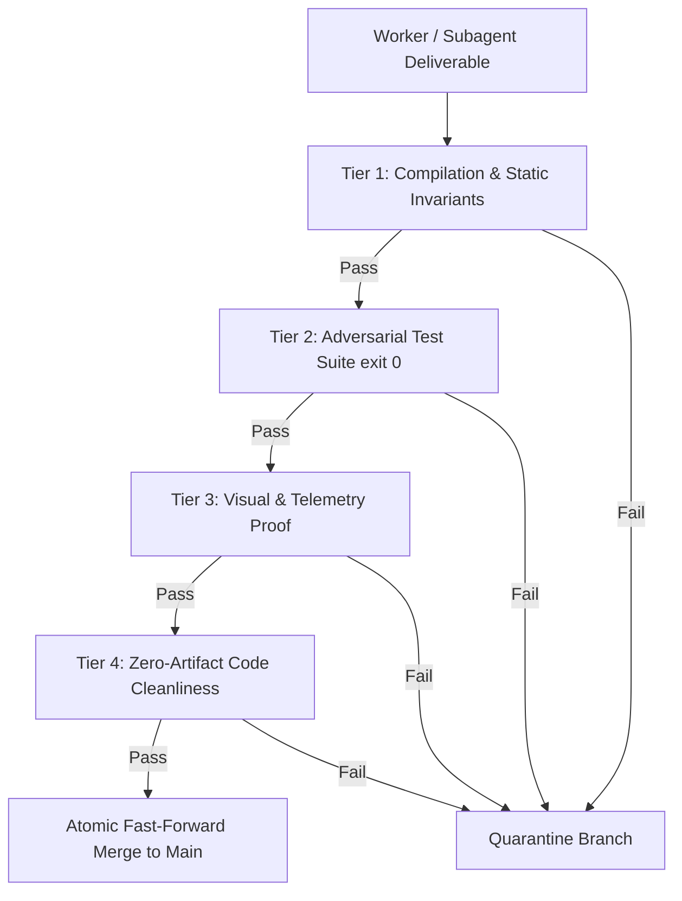

# 🛑 INTEGRATION CONSENSUS GATE PROTOCOL

> **Mandate**: Zero code originating from isolated worktrees, autonomous subagent branches, or invasive refactoring pipelines may merge into the main branch or trunk without passing the 4-Tier Deterministic Consensus Gate.

---

## 1. 🏛️ 4-TIER VERIFICATION FUNNEL



---

## 2. 📋 PRE-MERGE VERIFICATION CHECKLIST

Before executing branch integration or declaring a milestone complete, execute and document all four checks:

### Step 1: Deterministic Test Suite (`exit 0`)
Execute all unit and integration test suites:
```bash
python test_plugin.py
# or for Node.js / TypeScript projects:
npm test -- --coverage
```
- Assert: 100% test pass rate.
- Assert: Zero suppressed errors, zero hidden assertion failures.

### Step 2: Static Type & Contract Integrity
Verify that TypeScript, Python, or Rust type contracts are strictly intact:
```bash
# Python
python -m mypy --strict .
# TypeScript
npx tsc --noEmit
```

### Step 3: Visual & Interactive Telemetry Proof
If the deliverable touches UI, 3D WebGL, or CLI interactors:
- Validate rendering via Chrome DevTools MCP or Puppeteer snapshot (`puppeteer_screenshot`).
- Confirm zero visual regressions, no broken flex/grid wrappers, and 60fps rendering stability.

### Step 4: Forensic Hygiene & Zero-Placeholder Audit
Execute a diff scan across all modified files:
- Assert zero `TODO`, `FIXME`, `pass  # placeholder`, or synthetic mock arrays (`const MOCK = [...]`).
- Remove debugging statements (`console.log`, `print()`, breakpoint traps).
- Confirm all markdown links and references resolve 100% on disk.

---

## 3. 🛡️ QUARANTINE & ROLLBACK PROTOCOL

If any tier fails during consensus evaluation:
1. **Immediate Quarantine:** Isolate the failing branch into `quarantine/<issue-id>` without touching `main`.
2. **Causal Incident Report:** Trigger `causal-debugging-protocol` to generate a root-cause autopsy.
3. **Remediation Loop:** Dispatch a worker agent to apply an atomic fix under TDD constraints.
4. **Re-Gate Evaluation:** Re-run the full 4-Tier Gate from Tier 1.
